# نظام السجل الوظيفي والعلاوات والترفيعات

<p align="center"></p>

نظام مكتبي عربي (RTL) لإدارة السجل الوظيفي للموظفين، واحتساب العلاوات والترفيعات،
وتسجيل كتب الشكر وأوامر الترفيع/العلاوة ومرفقاتها، مع عمل موزّع بين مركز الدائرة
والمؤسسات الصحية، **دون إنترنت**، وتبادل بيانات عبر **USB**.

- **المواصفة المرجعية:** [المواصفة النهائية v1.1](المواصفة_النهائية_نظام_الموارد_الوظيفية_v1.1.md)
- **القرار المعماري:** [ADR-001](docs/ADR-001-architecture.md)
- **الإصدار الحالي:** 0.10.0 (المراحل 1–7 + المصفوفة + PDF/CSV + الشعار + تشفير القاعدة والحزم)
- **دليل التشغيل:** [docs/دليل_التشغيل.md](docs/دليل_التشغيل.md)
- **محضر الاستلام:** [docs/محضر_الاستلام.md](docs/محضر_الاستلام.md)

## 1. المعمارية باختصار

```text
عميل 1 ─┐
عميل 2 ─┼── شبكة داخلية ──► خدمة محلية (SQLite/WAL)
عميل 3 ─┘                        │
                                 └── USB: حزم بيانات/قواعد/نتائج
```

- **الخدمة** تحوي كل المنطق والصلاحيات والتدقيق. **العميل** واجهة فقط.
- **الوضع الافتراضي: مستخدم واحد** (خدمة + واجهة في عملية واحدة) — يعمل بلا أي إعداد.
- للمشاركة: `--server` على جهاز الخدمة، و`--client --server-url ...` على بقية الأجهزة.
- قاعدة SQLite واحدة لكل جهة، بوضع WAL، وكاتب واحد مُسلسَل.

## 2. التشغيل من المصدر

```powershell
$py = "$env:LOCALAPPDATA\Python\bin\python.exe"   # أو أي Python 3.12+
& $py -m pip install -r requirements.txt

# الافتراضي: مستخدم واحد — يبدأ الخدمة والواجهة معاً
& $py run.py

# من VS Code: افتح run.py واضغط Run (F5) — النتيجة نفسها.
# أو انقر «تشغيل.bat» في مجلد المشروع.

# مركز/مؤسسة متعددة المستخدمين: على جهاز الخدمة
& $py run.py --server --host 0.0.0.0 --port 8765
# على أجهزة العملاء (بعد معرفة عنوان جهاز الخدمة)
& $py run.py --client --server-url http://192.168.1.10:8765
```

- البيانات في مجلد `data` بجانب البرنامج (أو `--data-dir "D:\AMDH-Data"`).
- **أول تشغيل**: تُطلب **كلمة مرور تشفير القاعدة** (تُحفظ جيداً؛ لا يمكن استعادتها)،
  ثم يُفتح تلقائياً **إنشاء مدير المركز**.
- **الخدمة مع قاعدة مشفرة**: عيّن `AMDH_HR_DB_PASSPHRASE` في بيئة جهاز الخدمة.
- **لا تشغّل `run.py` كعميل بلا خدمة**: بدون `--server` سيبحث عن خدمة على
  `127.0.0.1:8765` ولن يقبل الدخول. للتشغيل المفرد استخدم `run.py` بلا وسائط.
- عند التحديث: استبدل ملفات البرنامج فقط، وأبقِ `data` كما هي (بما فيها `db.key.json`).

## 3. ما هو منفّذ (المراحل 1–7)

| البند | الحالة |
|---|---|
| خدمة محلية + عملاء + وضع مستخدم واحد | ✅ |
| تسجيل دخول إلزامي، قفل بعد المحاولات، جلسات | ✅ |
| أربعة أدوار ونطاق مؤسسة | ✅ |
| إنشاء مؤسسة مع عدد مستخدمين + مدير، تلقائياً | ✅ |
| كلمات مرور فريدة تُعرض مرة واحدة | ✅ |
| بطاقة دخول HTML جاهزة للطباعة (A4) | ✅ |
| طباعة قوائم المؤسسات والمستخدمين (HTML) | ✅ |
| تصفير كلمات مرور المؤسسة / حذفها مع مستخدميها | ✅ |
| نسخ احتياطي يدوي + فحص سلامة | ✅ |
| تجهيز نسخة مؤسسة (ZIP بقاعدة منقّاة) | ✅ |
| ثيمان: فاتح وداكن + تلقائي | ✅ |
| **الموظفون**: الرقم، الاسم، العنوان الوظيفي، الدرجة/المرحلة/الفئة، الجنس، الحالة | ✅ |
| **السجل الوظيفي**: تعيين، نقل، تغيير عنوان/درجة/مرحلة/حالة | ✅ |
| **العناوين الوظيفية** كسجل مرجعي للقواعد والاستهداف | ✅ |
| **التوزيع على المستخدمين** (الحصص) وقصر الرؤية على المخصص | ✅ |
| **تصدير/استيراد الموظفين Excel** + قالب | ✅ |
| **الوثائق**: مخزن ببصمة SHA-256، منع التكرار، ربط وفتح | ✅ |
| **كتب الشكر**: أنماط الاستهداف الخمسة، معاينة، أثر القواعد، اعتماد | ✅ |
| **أوامر الترفيع/العلاوة** فردية وجماعية، اعتماد، مرفقات، طباعة | ✅ |
| **محرر القواعد**: حزم مؤرخة، ترفيع/علاوة/أثر كتاب، نشر، إصدار جديد | ✅ |
| **محرك الاحتساب**: الخدمة + أثر الكتب + أهلية الترفيع/العلاوة + تحذيرات | ✅ |
| **التقارير**: 16 تقريراً تشغيلياً (سجل تاريخي، مستفيدون، مرفقات، فروقات موسّعة، المزامنة، النسخ) | ✅ |
| **عارض PDF/صور داخلي** وطباعة المرفقات | ✅ |
| **تصدير PDF مباشر** بخط عربي مشكّل | ✅ |
| **التصدير** HTML للطباعة، **PDF مباشر**، **CSV**، وExcel | ✅ |
| **تقرير فروقات القواعد الموسّع**: اختيار أي إصدارين، كل القواعد، النطاق، قبل/بعد | ✅ |
| **PDF لنتيجة الاحتساب** مع التاريخ والدرجة والقواعد والتنبيهات | ✅ |
| **شعار وأيقونة** للنظام (نافذة/شريط/حول/طباعة) | ✅ |
| **حزم USB**: تصدير بيانات مؤسسة، استيرادها في المركز، معاينة ومنع تكرار | ✅ |
| **حزم القواعد**: من المركز إلى المؤسسة عبر USB | ✅ |
| **حزم النتائج**: أوامر وكتب معتمدة من المركز إلى المؤسسة | ✅ |
| **تطبيق آلي للدرجة/المرحلة** عند اعتماد الأمر + سجل وظيفي وتدقيق | ✅ |
| **مصفوفة القِدَم المعتمدة**: 6 أشهر للرئاسة/الوزراء، شهر للوزير/المخوّل بسقف 3 أشهر سنوياً، وترحيل الفائض | ✅ |
| **تجهيز نسخة لكل مؤسسة** من زر «نسخة» بجانبها (برنامج + بيانات + بيانات الدخول) | ✅ |
| **حزم USB مشفرة** AES-256-GCM بكلمة مرور، مع دعم الحزم القديمة | ✅ |
| **تشفير القاعدة** SQLCipher بكلمة مرور عند التشغيل، ونسخ احتياطية مشفرة | ✅ |
| **حقول تاريخ الدرجة/المرحلة** لاحتساب 48/12 شهراً بدقة | ✅ |
| **شاشة تعارضات المزامنة**: قرار لكل موظف (نسخة المركز/المؤسسة) وربط السجل بالهوية المركزية | ✅ |
| **سجل حزم المزامنة** وحالة كل حزمة | ✅ |
| **نسخة تنفيذية** + حزمة توزيع + دليل تشغيل + محضر استلام | ✅ |
| تدقيق كل العمليات الحساسة | ✅ |

**المرحلة 7: مكتملة** — نسخة تنفيذية، حزمة توزيع، تحديث بالاستبدال، دليل تشغيل، محضر استلام.

### المزامنة عبر USB

```text
المؤسسة: المزامنة ← تصدير بيانات للمركز        ← data/exports/AMDH_<code>_<time>.amdhpkg
المركز:  المزامنة ← استيراد حزمة مؤسسة         ← معاينة ← نسخة احتياطية ← دمج
المركز:  المزامنة ← تصدير حزمة قواعد
المؤسسة: المزامنة ← استيراد حزمة قواعد
المركز:  المزامنة ← تصدير نتائج الاعتماد
المؤسسة: المزامنة ← استيراد نتائج الاعتماد
```
المؤسسة: المزامنة ← استيراد حزمة قواعد
```

- حزمة البيانات تحوي موظفي المؤسسة وسجلهم وكتبها وأوامرها ووثائقها (بلا مستخدمين ولا تدقيق).
- الاستيراد **لا يكرر** الحزمة نفسها، ويحفظ سجلها في «سجل الحزم».
- حزمة القواعد تحوي الإصدارات **المنشورة** فقط، وتُستورد في نسخة المؤسسة.
- الدمج لا يحذف شيئاً؛ تُحدَّث السجلات الأحدث ويُضاف الجديد فقط.

### لقطات الشاشة

| | |
|---|---|
| 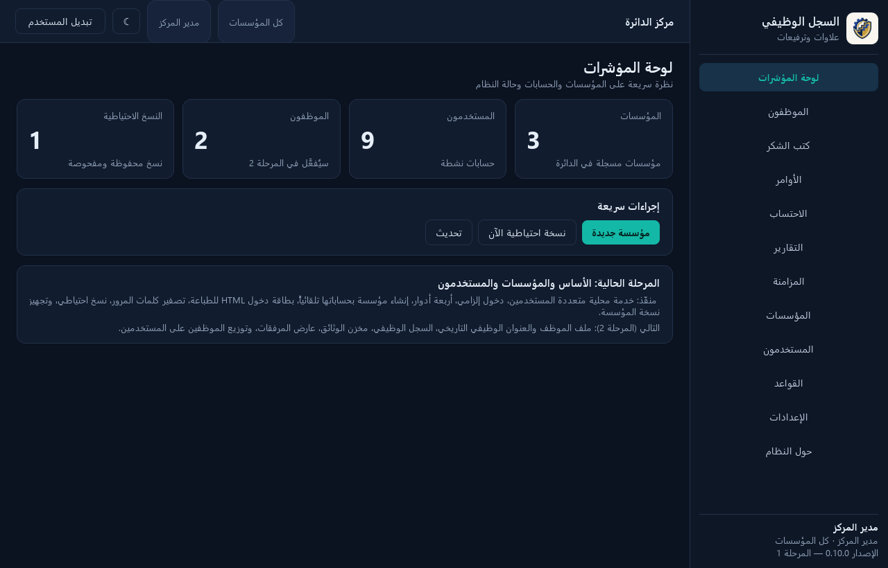 | 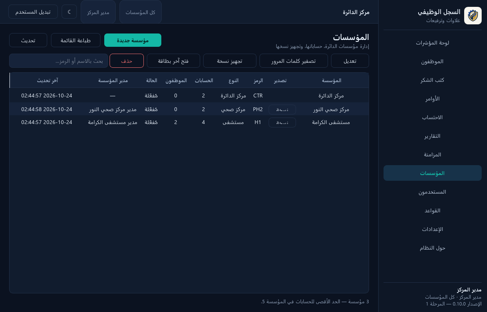 |
| 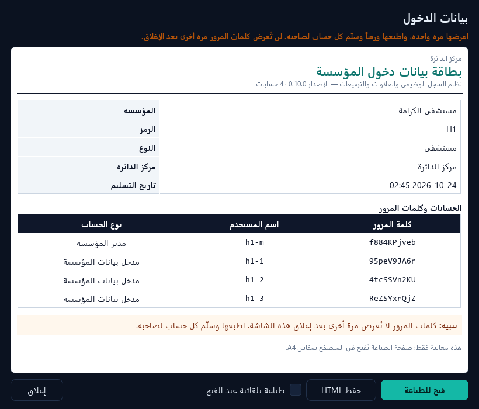 | 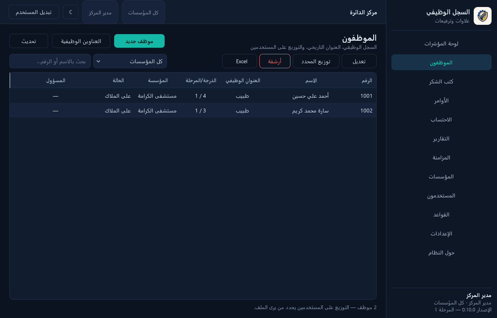 |
| 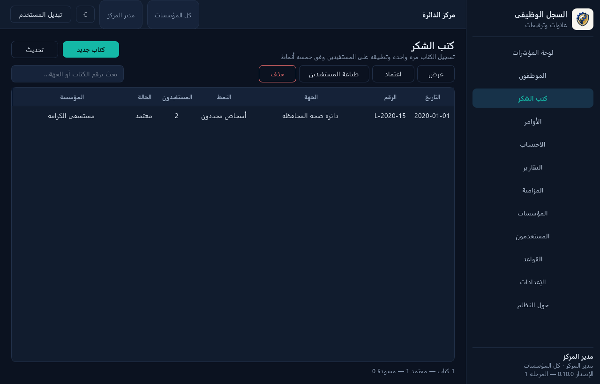 | 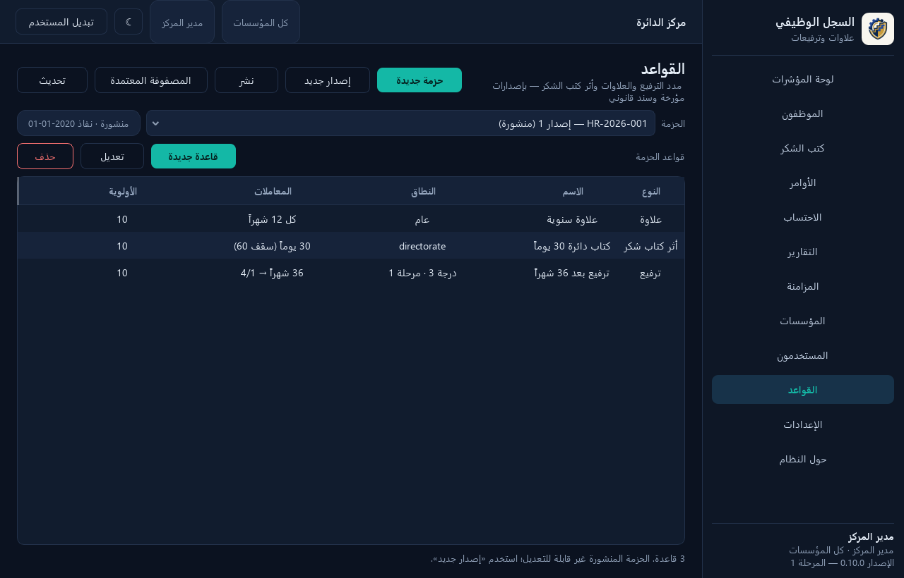 |
| 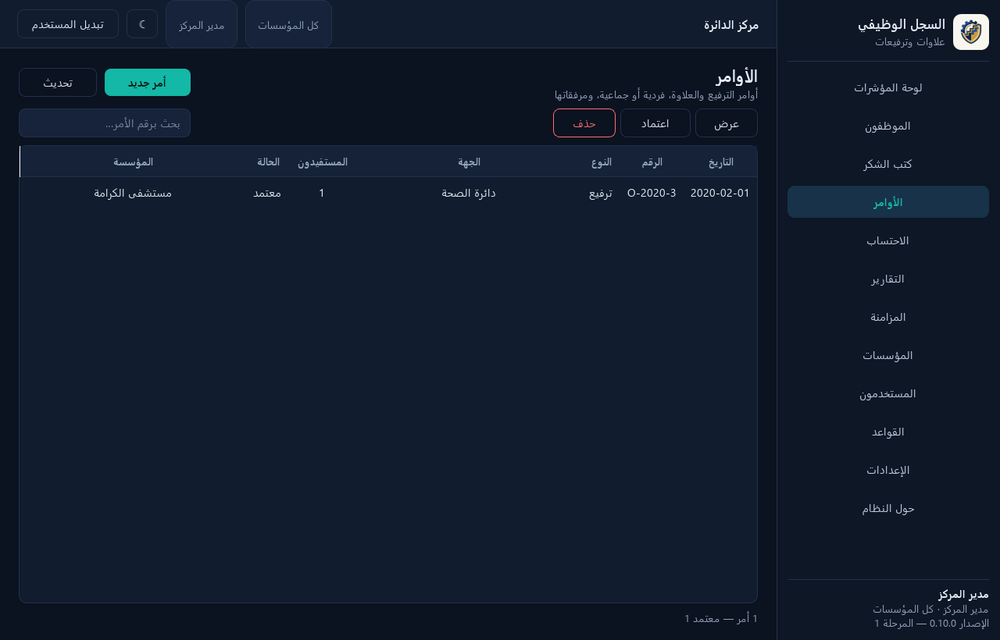 | 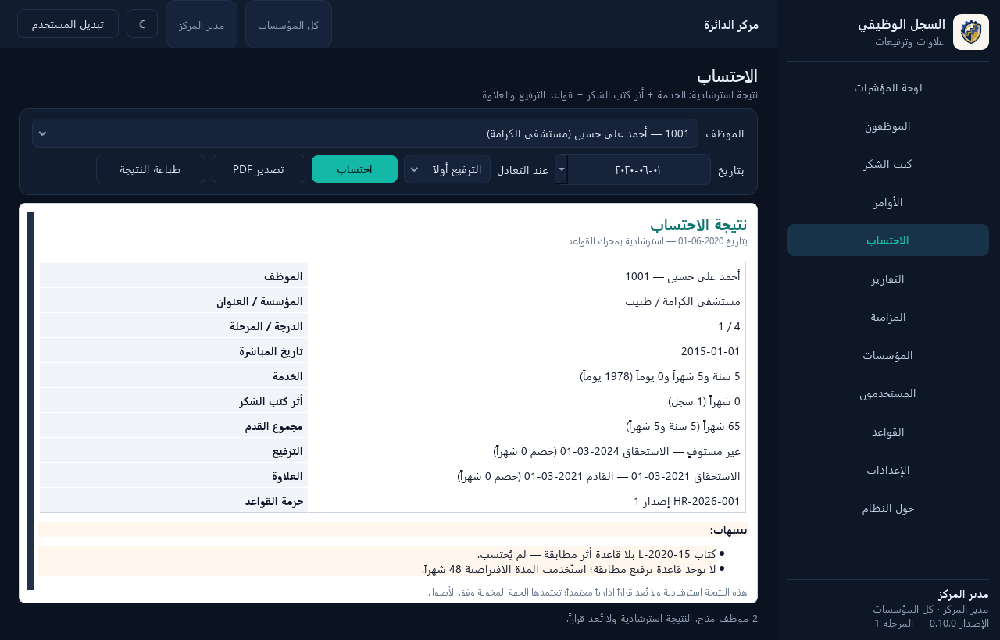 |
| 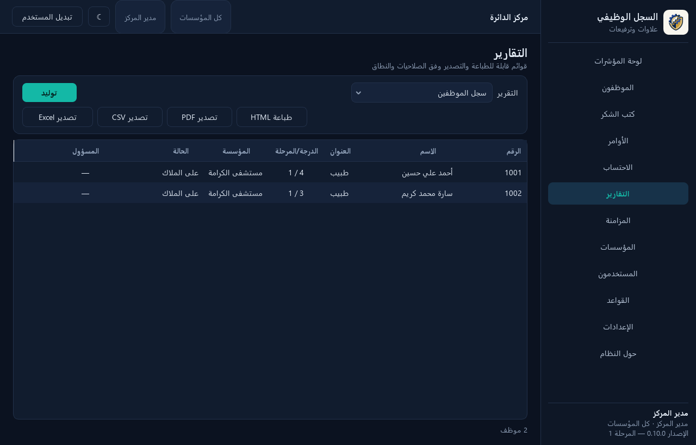 | 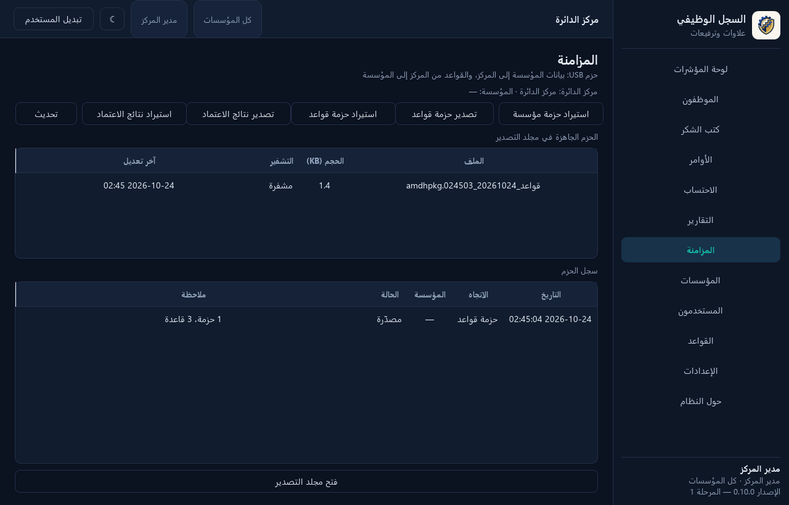 |
| 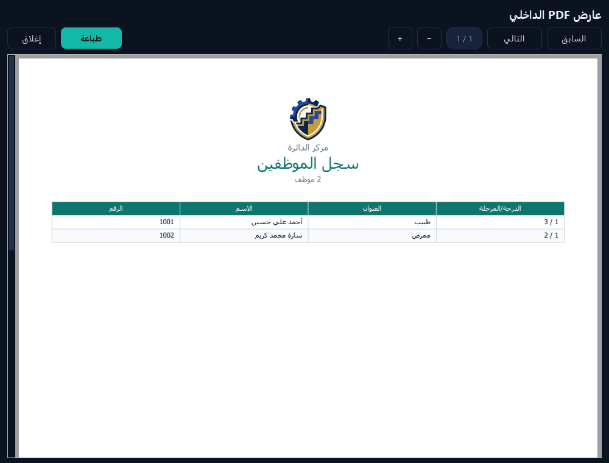 | 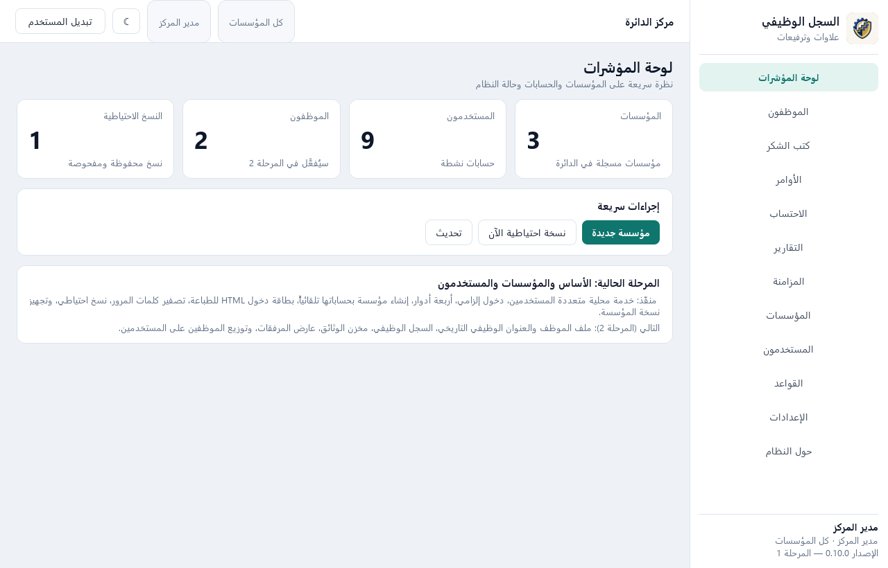 |

> لقطات مولّدة آلياً بـ `tools/smoke_ui.py` على قاعدة مؤقتة.

## 4. البنية

```text
run.py                     مشغّل الأوضاع
amdh_hr/
  config.py                الثوابت والمسارات
  util.py                  الوقت والتواريخ والأدوات
  security.py              تجزئة كلمات المرور والجلسات
  permissions.py           الصلاحيات والأدوار
  db.py                    المخطط (v2)، الترحيلات، المعاملات، التصدير النصي
  services/                auth | units | users | backup | provisioning | audit
                           employees | letters | orders | rules | calc | documents
                           reports | sync
  exporters/html.py        قوالب الطباعة A4
  exporters/excel.py       تصدير/استيراد Excel
  server/                  app (الخدمة) | http_api | client
  ui/                      theme | widgets | dialogs_* | pages_* | main_window
tests/                     اختبارات pytest
tools/                     لقطات الشاشة
```

## 5. الاختبارات

```powershell
& $py -m pytest
& $py tools\smoke_ui.py        # ينشئ قاعدة مؤقتة ولقطات في screenshots/
```

الحالة بعد المراحل 1–7: **57 اختباراً ناجحاً** تغطي التهيئة، الدخول والقفل، الأدوار
والنطاق، إنشاء المؤسسات وحساباتها، التصفير والحذف، النسخ الاحتياطي، تجهيز النسخة
(وتشغيلها مستقلةً)، تهريب HTML، واجهة HTTP، مسار الواجهة الكامل، الموظفين والنطاق
والتوزيع، القواعد والاحتساب، كتب الشكر الخمسة، الأوامر وتطبيقها الآلي، الوثائق،
استيراد Excel، التقارير وPDF، وعزل بيانات نسخة المؤسسة، ودورة حزمة USB كاملة،
و**12 حالة يدوية لمصفوفة القِدَم**، وسياسة التعادل، وحل تعارض المزامنة، وتشفير
SQLCipher والنسخ المشفرة.

## 6. بناء نسخة تنفيذية

```powershell
powershell -File tools\build_exe.ps1
# أو
& $py -m PyInstaller AMDH-HR.spec --noconfirm --clean
```

- الناتج: `dist\AMDH-HR\AMDH-HR.exe` (مجلد onedir، بلا قاعدة بيانات).
- يتضمن مجلد `_internal` كل ما يحتاجه البرنامج (PyQt6، openpyxl، الأيقونات).
- **عند التحديث**: استبدل `AMDH-HR.exe` و`_internal` فقط، وأبقِ `data` كما هي.
- أوضاع التشغيل: بلا وسائط (مستخدم واحد)، `--server`، أو `--client --server-url`.
- النافذة السوداء مخفية في النسخة التنفيذية؛ سجل الخدمة في `data\logs\app.log`.

### المثبّت (Inno Setup)

```powershell
powershell -File tools\build_exe.ps1
powershell -File tools\build_installer.ps1
```

- الناتج: `dist\installer\AMDH-HR_Setup_0.10.0.exe`.
- تثبيت **لكل مستخدم** في `%LOCALAPPDATA%\Programs\AMDH-HR` بلا صلاحيات مدير.
- ملف واحد يمنع فك ZIP اليدوي أو استبدال ملفات أثناء النقل.
- يُنشئ اختصاراً في قائمة ابدأ وسطح المكتب، ومُزيل تثبيت.
- **لا يحذف `data`** عند إزالة التثبيت (قاعدة البيانات والمفتاح والمرفقات تبقى).
- تُنشأ `SHA256SUMS.txt` للتحقق من سلامة الملفات بعد التثبيت.
- **لا توقيع رقمي**: المثبّت يقلل العبث العابر، لكن التحقق القاطع يحتاج توقيعاً أو مقارنة SHA-256 المنشورة.

## 7. استكشاف الأخطاء

| المشكلة | الحل |
|---|---|
| شاشة الدخول لا تقبل | شغّل `python run.py` **بلا وسائط** (مستخدم واحد). لا تشغّله كعميل بلا خدمة. |
| «تعذّر الاتصال بالخدمة» | شغّل `run.py` مباشرة، أو على جهاز الخدمة: `run.py --server` ثم أدخل عنوانه. |
| اسم المستخدم | هو ما في بطاقة الدخول (مثل `unit-1` أو `h1-m`)، وليس الاسم العربي. |
| كلمة المرور | حساسة لحالة الأحرف؛ استخدم زر «إظهار» للتأكد. تُهمَل المسافات الطرفية تلقائياً. |
| نسيت كلمة مرور admin | `python tools/reset_password.py --username admin` (أغلق البرنامج أولاً). |
| بطاقة الدخول المفقودة | الملفات المحفوظة في `data/reports/` (تحتوي كلمات المرور؛ احذفها بعد التسليم). |
| الحساب مقفل | `python tools/reset_password.py --username <name>` يفتح القفل ويصفّر المحاولات. |

## 8. ملاحظات

- **آخر نسخة تنفيذية مبنية: 0.4.0** في `dist\AMDH-HR\AMDH-HR.exe` — **لم تُبنَ 0.10.0**
  بناءً على طلبك (2026-10-24). المصدر الحالي 0.10.0 ويشمل الاعتماد الآلي، المصفوفة،
  التقارير وPDF/CSV، عارض المرفقات، الشعار، وتشفير القاعدة والحزم.
- حزمة التوزيع الحالية `dist\AMDH-HR_0.4.0.zip` لا تشمل ميزات 0.5–0.10؛ تُبنى عند طلبك.
- دليل التشغيل ومحضر الاستلام في مجلد `docs` (يصفان المصدر الحالي 0.10.0؛ النسخة التنفيذية المسلَّمة 0.4.0).
- لم يُوقّع الـEXE رقمياً؛ ستظهر رسالة SmartScreen عند أول تشغيل في الأجهزة الجديدة.
- **التشفير مفعّل**: عند أول تشغيل تُطلب كلمة مرور تشفير القاعدة (لا يمكن استعادتها).
  القاعدة والنسخ الاحتياطية مشفرة بـSQLCipher، وملف اشتقاق المفتاح في `data\db.key.json`.
- لتشغيل الخدمة (`--server`) مع قاعدة مشفرة: عيّن `AMDH_HR_DB_PASSPHRASE`.
- حزم USB تُصدَّر **مشفرة بكلمة مرور** (AES-256-GCM)؛ تُطلب عند التصدير والاستيراد.
  الحزم القديمة غير المشفرة تُستورد بكلمة مرور فارغة.
- التجهيز الكامل (تضمين ملفات البرنامج) يتطلب تشغيل النسخة التنفيذية.
- تُحفظ قاعدة البيانات والنسخ والمرفقات في `data`؛ لا تُدرج في Git.
